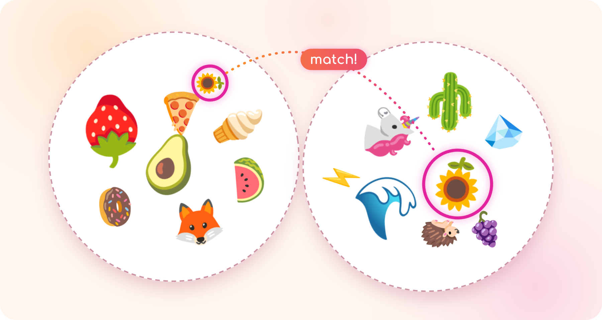
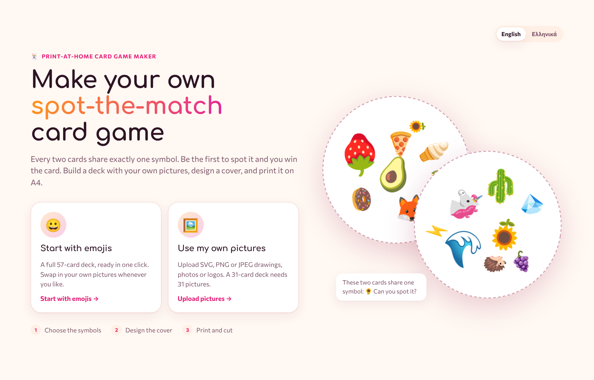
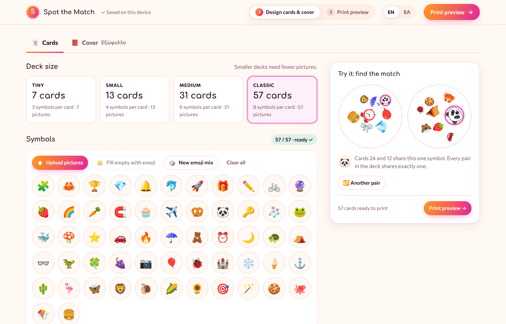
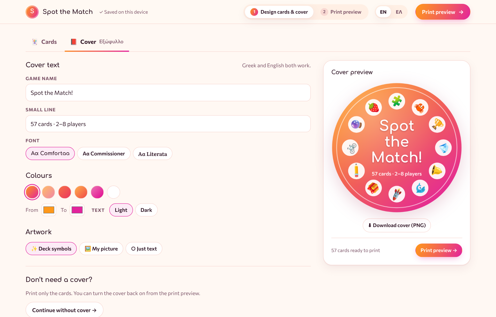
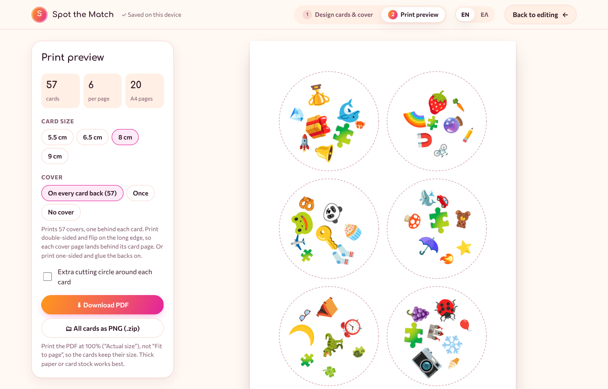

<p align="center">
  
</p>

<h1 align="center">Spot the Match</h1>

<p align="center">
  <b>Make your own spot-the-match card game, then print it at home.</b><br>
  <i>Φτιάξε το δικό σου παιχνίδι «Βρες το ίδιο!» και τύπωσέ το στο σπίτι.</i>
</p>

<p align="center">
  
  
  
  
</p>

---

## The game in one sentence

**Any two cards in the deck share exactly one symbol, and the first player to spot it wins.**

Look at the two cards above. They have 16 symbols between them, and only one, the 🌻 sunflower, appears on both. The deck is built so that this holds for *every* pair of cards, whichever two you pick.

Spot the Match builds such a deck from your own pictures: family photos, your kid's drawings, your team's logos, letters of the alphabet for a classroom. You can also start from a ready-made emoji set. You design a cover and download a PDF ready to print.

## How to play

You need the printed deck and 2 to 8 players. Each round is a race: everyone looks at the same cards at once, and the first to **name the shared symbol out loud** wins the round.

### 🏁 The race (the classic)

1. Deal one card face down to each player. Put the rest in a face-up pile in the middle.
2. On "go", everyone turns over their card.
3. Find the symbol your card shares with the top of the pile, and say it out loud.
4. The first to say it takes the top card and puts it on top of their own. Now there's a new card to match.
5. When the pile runs out, whoever collected the most cards wins.

### 🔥 Get rid of them

1. Deal out every card except one, and put that one face up in the middle.
2. Everyone keeps their stack face up in front of them.
3. Spot the match between **your** top card and the middle card, say it, and place your card on the middle.
4. The first player with no cards left wins.

### 🧸 For little ones

Choose the **Tiny** deck: 7 cards with 3 big symbols each. Lay two cards side by side and ask *"What's on both?"* It's a great first game for ages 3 and up.

> **House rule ideas:** play with no talking (point at the symbol instead), or with a sand timer. You can also make a "family deck" where every symbol is a person in the family.

## Make your own deck

Everything happens in four short steps in your browser. Nothing is uploaded anywhere.

### 1. Pick how to start



- **😀 Start with emojis:** a full 57-card deck, ready in one click. You can swap in your own pictures any time.
- **🖼️ Use my own pictures:** start from an empty deck and upload SVG, PNG or JPEG files.

### 2. Choose the symbols and the card look



Pick a deck size. Smaller decks need fewer pictures:

| Deck | Cards | Symbols per card | Pictures you need |
|---|:---:|:---:|:---:|
| **Tiny** | 7 | 3 | 7 |
| **Small** | 13 | 4 | 13 |
| **Medium** | 31 | 6 | 31 |
| **Classic** | 57 | 8 | 57 |

Then fill the circles:

- **Upload** several pictures at once, or drag them onto the grid. They fill the empty circles first.
- **Tap a circle** to replace that one symbol, or **✕** to remove it.
- **Fill empty with emoji** if you run out of pictures.
- Choose a **card colour** and a **border**. The default border is a dashed cutting line; you can also pick a solid colour or no border at all.
- **Rotate** and **Mixed sizes** make the cards harder, like the real game. **Shuffle layouts** rearranges every card.

The panel on the right deals you a random pair of cards with the shared symbol circled, so you can try the game while you build it.

### 3. Design the cover (Εξώφυλλο)



- **Text:** write the game name and a small line underneath, in Greek or English.
- **Font:** pick one of three: Comfortaa, Commissioner or Literata.
- **Colours:** five orange-to-pink gradients, a **white** cover, or any two colours of your own.
- **Artwork:** your deck's symbols around the edge, your own picture in the middle, or just text.
- **No cover:** if you don't want one, use **Continue without cover →**.

### 4. Print



- **Card size:** 5.5, 6.5, 8 or 9 cm. The preview shows the real A4 pages and the page count.
- **Cover:** print it **on every card back** (one per card), **once** (for the box), or not at all.
- **Download PDF** to print, or **download all cards as PNGs** in a .zip.

#### Printing tips

- Print at **100% / "Actual size"**, never "Fit to page", so the cards keep their size.
- For covers on the back, print **double-sided, flipping on the long edge**. Each page of covers is laid out to land exactly behind its page of cards. If your printer can't print double-sided, print one-sided and glue the covers on.
- **Card stock (200–300 g/m²)** feels like a real deck. A circle cutter or a large round punch makes cutting much quicker than scissors.
- Laminate the cards if little hands will play with them.

## Why it works: the maths

The deck is a **finite projective plane**, a structure from geometry where any two lines always meet in exactly one point. Each card is a "line" and each symbol is a "point".

For a prime number *n*, the plane has:

- **n² + n + 1** cards, and the same number of symbols,
- **n + 1** symbols on every card,
- each symbol appearing on **n + 1** cards,
- and **exactly one** symbol shared by any two cards.

With *n* = 7 that gives the classic 57-card deck with 8 symbols per card. The app uses *n* = 2, 3, 5 and 7, and the generator has been checked for every pair of cards at each size.

<details>
<summary>The construction, in code</summary>

```js
// Cards for a projective plane of prime order n.
// Symbols are numbered 0 … n² + n.
function generateLayout(n) {
  const cards = [];
  // n + 1 cards through symbol 0
  for (let i = 0; i <= n; i++) {
    const card = [0];
    for (let k = 0; k < n; k++) card.push(1 + i * n + k);
    cards.push(card);
  }
  // n² more cards, one per (slope, offset) pair
  for (let g = 0; g < n; g++) {
    for (let i = 0; i < n; i++) {
      const card = [g + 1];
      for (let k = 0; k < n; k++) card.push(1 + n + n * k + ((i + g * k) % n));
      cards.push(card);
    }
  }
  return cards;
}
```

Symbols are then scattered on each round card at random positions, sizes and angles, with a simple collision check so nothing overlaps.

</details>

## Features

- 🎴 Four deck sizes, from 7 to 57 cards
- 🖼️ Your own SVG, PNG or JPEG pictures, mixed freely with emoji
- 🎨 Card colour, border style, rotation and size mix, with a live "find the match" preview
- 📕 A cover designer with Greek-ready fonts, gradients, a white option and your own artwork
- 🖨️ A4 print preview, PDF download, a PNG zip and covers on the card backs for double-sided printing
- 🌍 English and Ελληνικά, switchable at any time
- 💾 Your deck is saved in your browser automatically, so you can come back to it later
- 🔒 Private by design: your pictures never leave your device

## Your pictures and privacy

Spot the Match has no server. Pictures are processed in your browser and saved only in that browser's own storage (IndexedDB) on your device, so you can close the page and continue later. **Start a new deck** on the welcome screen erases it.

Clearing your browser data, or using a private window, removes the saved deck.

## Run it yourself

There's no build step and nothing to install.

```bash
git clone https://github.com/<you>/spot-the-match.git
```

```bash
cd spot-the-match
```

Then open `index.html` in any modern browser. To share it, turn on **GitHub Pages** for the repo (Settings → Pages → deploy from the `main` branch) and send people the link.

### What's inside

```
spot-the-match/
├── index.html      ← the whole app: markup, styles and script
├── README.md
├── LICENSE
└── assets/         ← images used in this README
```

### Built with

- Plain HTML, CSS and JavaScript, with cards drawn on `<canvas>`
- [jsPDF](https://github.com/parallax/jsPDF) 2.5.1 for the PDF and [JSZip](https://stuk.github.io/jszip/) 3.10.1 for the zip, loaded from cdnjs
- [Comfortaa](https://fonts.google.com/specimen/Comfortaa), [Commissioner](https://fonts.google.com/specimen/Commissioner) and [Literata](https://fonts.google.com/specimen/Literata) from Google Fonts, all with Greek support

Emoji are drawn with your device's own emoji font, so they look slightly different on Apple, Windows and Android devices.

## License

[MIT](LICENSE). You're free to use, change and share it, including in schools and clubs.
